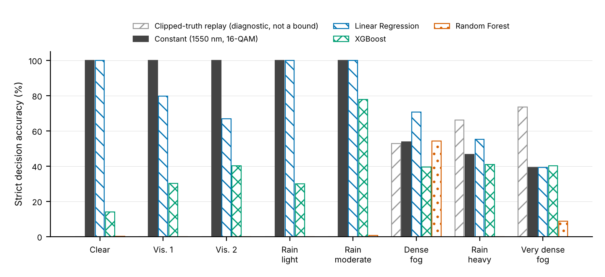

# Decision-Level Evaluation of ML Surrogates for OFDM-FSO Configuration Selection Under Unseen Atmospheric Conditions: Censoring Artifacts and Trivial-Baseline Pitfalls

> **Final-candidate note (2026-10-21).** This file is a new working copy. `IEEE_Paper_Final_Handoff.md`, `IEEE_Paper_Revised.md` and `IEEE_Paper_Draft.md` are preserved unchanged. Compared with the Final Handoff version, this candidate (i) re-titles the paper, (ii) withdraws or rewrites the claims in the Abstract, Contributions, §VII-F–I, §VIII and §X that an audit of the saved predictions showed to be confounded (see the change log in `Final_Candidate_Completion_Checklist.md`), (iii) adds §V-F/G, §VII-L–N and the related-work paragraph on adaptive-ML work in FSO, with references 10–13, 22 and 23, and (iv) incorporates a final audit (2026-10-22) that corrected the "ceiling" terminology (the replay of Rule B on clipped truth is a diagnostic, not an upper bound), demoted the censoring-equivalent score to a lenient diagnostic, and made every macro/micro statement explicit. All Phase 5 datasets, folds, hyperparameters and result tables are unchanged. The new analyses are post hoc and are labelled as such. The working title used in the author's sprint brief ("Robust ML-Based Wavelength Selection…") is not used: the results do not demonstrate robustness, and the paper evaluates configuration (wavelength and modulation) selection.

**Ramesh Yadav**
Department of Electronics and Communication Engineering, National Institute of Technology Delhi, New Delhi, India

---

## Abstract

Machine learning (ML) surrogates have been proposed to support adaptive wavelength and modulation selection in OFDM free-space optical (OFDM-FSO) links and are usually judged by regression accuracy on random train/test splits. We evaluate such surrogates at the decision level under atmospheric conditions absent from training. We build a physics-grounded analytical dataset of 10,433 environmental states (62,598 configuration rows; three wavelengths × two M-QAM orders) with a deterministic lexicographic decision rule (maximize bit rate subject to BER ≤ 10⁻⁹, then BER margin, then a fixed wavelength order) as ground truth, and benchmark five regressors under random-split, Leave-One-Weather-Condition-Out (LOWCO, eight regimes) and parameter-range-holdout protocols. Random Forest reaches R²≈0.952 on a random split, yet mean LOWCO R² is negative for all five models. Under strict decision matching, Linear Regression ranks first (76.4% macro, 61.0% micro) and Random Forest last (8.0%, 5.6%); macro is the mean over regimes and micro is pooled over environments. An audit shows that this ranking is largely an artifact of the benchmark. Regression targets are clipped at log₁₀ BER = −20, so in deep-feasible regimes candidate BERs tie exactly at the floor and the rule's fixed-order tie-break (850 nm first) disagrees with a ground truth computed from unclipped margins. Replaying the rule on the true clipped BERs matches the ground truth in only 24.0% of environments on a macro basis (49.8% micro), but in 100.0% (99.9%) if the tie-break order is reversed; this replay is a diagnostic, not an upper bound. A constant "1550 nm, 16-QAM" policy scores 79.9% macro, above every regression-based selector, but 59.1% micro, below Linear Regression (61.0%), because five of the eight regimes have that single label. Only Dense Fog, Rain: Heavy and Very Dense Fog involve a genuine contest. Over these three regimes mean strict accuracy is 55.0% for Linear Regression, 46.5% for the constant policy, 20–40% for the other four regressors and 50–55% for untuned direct classifiers; in Very Dense Fog no model is more than 2.7 points above the constant policy. We conclude that regression metrics alone are an unreliable proxy for decision quality under atmospheric shift, and that decision-level evaluation needs trivial baselines in both macro and micro terms, per-regime reporting and a check of how ties are broken. We do not demonstrate a reliable ML-based adaptive FSO controller or robust generalization to unseen atmospheric conditions.

**Keywords:** free-space optics, OFDM, machine learning, adaptive modulation, wavelength selection, distribution shift, model evaluation, target censoring, bit error rate prediction

---

## I. Introduction

Free-Space Optics (FSO) offers high-bandwidth, unlicensed, and rapidly deployable optical wireless links, but link availability is strongly limited by atmospheric conditions, chiefly fog (Mie scattering) and, to a lesser degree, rain [1], [2]. Orthogonal Frequency Division Multiplexing (OFDM) has been applied to FSO and radio-over-FSO links [3], and adaptive selection of transmission wavelength and modulation order has been proposed as a mitigation strategy that trades throughput against reliability as conditions change [1], [4].

Machine learning can serve as a computationally cheap surrogate for the expensive physical simulation or measurement needed to evaluate link performance; for example, Random Forest (RF) and Linear Regression (LR) have been applied to simulated OFDM-FSO data to predict the best wavelength, with RF reported to be more accurate than LR [4]. Evaluating such surrogates with a random train/test split and a regression metric such as the coefficient of determination (R²) has two specific weaknesses relevant to this work. First, when the prediction target is categorical (e.g., which of several discrete wavelengths is best), R² is not a natural fit metric, and a random split can overstate performance when nearby simulated points share structure across the train/test boundary [5]. Second — and the focus of this paper — even when the regression target is reframed as continuous (e.g., log-BER), a random split evaluates interpolation within a training distribution, not extrapolation to atmospheric regimes absent from training, which is the actual operating condition an adaptive controller must handle in deployment.

We further argue that adaptive configuration selection is not merely a regression problem: the deployed system does not need an accurate absolute BER estimate so much as it needs the *ordering* of a small set of candidate configurations to be correct, together with a reliable feasibility judgment against a target BER. A model can therefore have large absolute prediction error yet make correct decisions, or small absolute error yet make incorrect decisions, depending on how error is distributed across the candidate set. This distinction is not addressed by regression metrics alone.

This leads to our central research question: *does strong random-split regression performance predict good adaptive-configuration-decision performance under atmospheric conditions unseen during training?* We answer this empirically using a physics-grounded OFDM-FSO dataset, a rule-based decision layer applied identically to ground-truth and ML-predicted BER, and a Leave-One-Weather-Condition-Out (LOWCO) evaluation protocol. Auditing our first-pass answer exposed two evaluation-design pitfalls (target censoring and trivial-baseline dominance); we report these as findings in their own right.

**Contributions:**
1. We provide a decision-level, environment-grouped LOWCO evaluation protocol (eight regimes, plus an independent parameter-range holdout) for ML surrogates of an OFDM-FSO configuration controller, with a deterministic ground-truth decision rule applied identically to true and predicted BER.
2. We show that random-split regression performance (R² up to 0.952) does not carry over to unseen atmospheric regimes: mean LOWCO R² is negative for all five models.
3. We show that strict decision-match accuracy on this benchmark is dominated by two effects unrelated to decision modelling: (a) exact ties at the −20 clipping floor interact with Rule B's fixed-order tie-break, so that replaying the rule on the true clipped BERs matches the ground truth in only 24.0% macro (49.8% micro) of environments, and in 100.0% (99.9%) with the tie-break order reversed (a post hoc illustration); this replay is a diagnostic and not an upper bound; (b) class dominance, since a constant 1550 nm / 16-QAM policy scores 79.9% macro, above every regression-based selector, but 59.1% micro, below Linear Regression (61.0%). We recommend reporting trivial baselines in both macro and micro terms, per-regime results and a tie-handling diagnostic alongside strict accuracy.
4. We identify the three regimes with a genuine decision contest (Dense Fog, Rain: Heavy, Very Dense Fog), compare all selectors there (mean strict accuracy: Linear Regression 55.0%, constant policy 46.5%, other regressors 20–40%, direct classifiers 50–55%), and show that the association between regression R² and strict decision accuracy is weak and unstable across scoring rules (ρ=0.12 strict; 0.54 under a lenient tie-tolerant diagnostic).
5. We provide a transparent, documented and sensitivity-tested physical parameterization (including a full-pipeline rain-coefficient rerun, §VII-K), a reproduction check of the saved results (§VII-N), and an explicit audit trail, as a reusable evaluation template.

---

## II. Related Work

**OFDM-FSO systems and atmospheric modeling.** OFDM has been analyzed for FSO and radio-over-FSO links under gamma–gamma atmospheric turbulence, with closed-form bit-error and outage expressions [3]. Attenuation modeling for FSO commonly separates fog (Mie-scattering regime, strongly wavelength-dependent) from rain (geometric-optics regime, approximately wavelength-independent [2]); we adopt the Kim model for fog [6] and, for rain, the power-law form γ = kR^α with the France coefficients (k = 1.076, α = 0.67) tabulated in the original 2007 edition of Rec. ITU-R P.1814 [7]; the same coefficients appear, attributed to Carbonneau, in a survey preprint [8]. The current edition of the Recommendation [2] gives different, drop-size-distribution-dependent coefficients; §VII-K and §IX report a full-pipeline test of the sensitivity of our results to this difference.

**ML-based wavelength prediction for FSO.** Prior work has applied supervised ML to predict a suitable wavelength for OFDM-FSO links under varying weather: [4] simulates OFDM-FSO transmission at 850, 1250 and 1550 nm in OptiSystem across weather conditions and reports that Random Forest predicts the best wavelength more accurately than Linear Regression. The best wavelength is a categorical target, and scoring it with a regression metric such as R² would be a metric/target mismatch — one we avoid here by using a continuous log-BER target and a separate, explicit decision layer.

**Distribution-shift and generalization evaluation in ML.** Learning methods commonly assume i.i.d. source and target data, an assumption often violated under domain shift, and domain generalization aims at out-of-distribution generalization using only source-domain data [9]; cross-validation that ignores data structure has been shown to seriously underestimate predictive error [5]. To our knowledge, this concern has not been previously operationalized for OFDM-FSO configuration-selection surrogates via a Leave-One-Weather-Condition-Out protocol with environment-level (not row-level) splitting.

**Adaptive ML in FSO beyond wavelength prediction.** Other ML work for FSO and optical wireless links predicts link performance or selects a transmission mode. Younes *et al.* [10] predict BER for simulated OFDM-FSO links under fog, rain and clear conditions with SVR, a decision tree and Random Forest, and report R² and MSE (the page we reviewed does not state the split). Shao *et al.* [11] use a Random Forest to classify the modulation format of a hybrid FSO/RF link from rainfall and visibility, evaluated by classification accuracy on a separate weather data set. Derouiche *et al.* [12] regress the turbulence strength Cn² and use a deep neural network to select the modulation of a mixed FSO/MIMO-mmWave link. Esmail [13] uses a Random Forest to classify modulation format and baud rate and to estimate Cn² and OSNR in simulation, with a random split on a fixed parameter grid and the wavelength fixed at 1550 nm. As described in the pages and abstracts we reviewed, none of these works evaluates held-out weather regimes or compares decision quality with regression quality. Our review of this literature used a general web search and page-level reading, not IEEE Xplore, Scopus or Web of Science, so the absence of such work from our list is not evidence that none exists.

**Gap addressed.** In the sources we reviewed, we did not find an OFDM-FSO ML study that evaluates configuration-selection surrogates at the decision level under atmospheric regimes structurally absent from training, or that compares regression accuracy with decision accuracy across candidate models. We make no claim of priority beyond that scope. This paper addresses the gap and, in doing so, documents evaluation pitfalls that such a study must control for.

---

## III. System Model and Problem Formulation

### A. OFDM-FSO Link Model
We model a coherent-detection OFDM-FSO link: a pseudo-random bit stream is mapped to M-QAM symbols (M∈{4,16}), OFDM-modulated, converted to the optical domain via dual Mach–Zehnder modulators driven by a continuous-wave laser, propagated through the atmospheric channel, and recovered via heterodyne coherent detection. OFDM-FSO links are simulated at waveform level in OptiSystem in [4]; the coherent-detection architecture assumed here is our own modeling choice, and the analytical BER/SNR treatment described below replaces full waveform-level simulation.

### B. Atmospheric Attenuation
Fog attenuation follows the Kim model [6]:
$$\beta_{fog}(\lambda) = \frac{3.91}{V}\left(\frac{\lambda}{550}\right)^{-P}$$
with V in km, λ in nm, and P a piecewise function of V (P=1.6 for V>50 km; 1.3 for 6<V≤50 km; 0.16V+0.34 for 1<V≤6 km; V−0.5 for 0.5<V≤1 km; 0 for V<0.5 km). Rain attenuation follows the power-law form γ = kR^α [2], [7] with the France coefficients of [7, Table 2]:
$$\gamma_{rain} = 1.076\,R^{0.67}\ \text{dB/km}$$
Consistent with current ITU-R guidance [2], rain attenuation is treated as wavelength-independent; [2] reports it as flat from the visible to the near-IR region, which we take to include 1250 nm, in agreement with the physical reasoning that rain droplets are large relative to all three wavelengths (geometric-optics regime). The coefficients of [7] differ from those of the current edition [2] (§IX); §VII-K reports a full-pipeline test of this difference's effect on every major result, using the current edition's μ=0 coefficients. Fog and rain are treated as mutually exclusive scenarios in this study, a simplification (§IX); the full ITU-R statistical (CCDF) combination of simultaneous fog and rain [2] is not implemented.

### C. Link Budget and Coherent Receiver SNR
Geometric loss follows [14, Sec. 3.5]:
$$GL(\text{dB}) = 10\log_{10}\left[\frac{D_r^2}{(D_t + L\theta)^2}\right]$$
with D_t=5 cm, D_r=15 cm, θ=5 mrad (full-angle), which are assumed representative modeling values, not specifications taken from a verified product datasheet. The link budget is
$$P_r(\text{dBm}) = P_t(\text{dBm}) - L_{atm}(\text{dB}) + GL(\text{dB})$$
where GL is signed (negative for any realistic link) and L_atm is the fog- or rain-attenuation loss over the link distance. Received electrical SNR follows the shot-noise-limited coherent heterodyne result:
$$SNR_{het} = \frac{\mathcal{R}P_r}{qB} = \frac{\eta P_r}{h\nu B}$$
where 𝓡 is detector responsivity (A/W), η=𝓡hν/q is the corresponding quantum efficiency, and B is the receiver bandwidth. This assumes a strong local oscillator (LO-shot-noise-limited operation), with thermal noise, LO relative-intensity noise, laser phase noise, and APD excess-noise all neglected — a first-order analytical treatment, not a full receiver simulation.

### D. M-QAM BER Model
We adopt a fixed symbol-rate convention, R_s=B=2.5 GHz for both modulation orders — not a fixed data-rate convention — so that bit rate, not bandwidth, varies with M:
$$R_b = R_s\log_2 M \Rightarrow R_b=5\text{ Gbps (4-QAM)},\ 10\text{ Gbps (16-QAM)}$$
BER follows the standard square M-QAM AWGN approximation [15, Sec. 4.3-3], assuming Gray-coded bit mapping and neglecting the squared term in the exact square-QAM symbol-error probability:
$$BER \approx \frac{4}{\log_2 M}\left(1-\frac{1}{\sqrt{M}}\right)Q\!\left(\sqrt{\frac{3\,SNR}{M-1}}\right)$$
This reduces to $BER=Q(\sqrt{SNR})$ for 4-QAM and $BER=0.75\,Q(\sqrt{SNR/5})$ for 16-QAM. Given the flat, non-dispersive channel assumed here (no multipath, no frequency-selective turbulence), this single-carrier expression is applied directly as the OFDM aggregate BER, since every subcarrier sees identical channel gain and noise under this model; laser phase noise/common-phase-error effects specific to coherent optical OFDM are not modeled and are stated as a limitation (§IX). BER is computed via a numerically stable log-domain path (avoiding float64 underflow for very small BER), yielding an uncensored value `log10_BER_raw` used for all physical decision-making, and a separate, ML-target-only censored value:
$$\log_{10}(BER_{target}) = \max(\log_{10}(BER_{raw}), -20)$$
The −20 floor is an ML-target censoring limit, introduced because the decision boundary (10⁻⁹) renders any BER below roughly 10⁻²⁰ operationally equivalent, while uncensored values (which can reach below −10⁵ for short, clear links) would dominate a regression loss function without providing decision-relevant signal. **It is not a physical noise floor and is never used for ground-truth decision-making.**

### E. Configuration Space and Rule-B Decision
Six candidate configurations are evaluated per environmental state: λ∈{850,1250,1550} nm × M∈{4,16}. Transmit power is fixed at P_t(850)=12.04 dBm (16 mW), an assumed modeling value rather than a verified commercial specification, scaled for 1250/1550 nm by an eye-safety-motivated multiplier of 50× (tested for robustness over 1×–65×, §VII-B). Detector responsivity is 𝓡(850)=0.5 A/W (silicon; an assumed typical value, no datasheet cited), 𝓡(1550)=0.95 A/W (InGaAs; the Hamamatsu G12180 series specifies 0.9 A/W minimum and 1.1 A/W typical at 1.55 µm [16], and the OSI FCI-InGaAs-1500 lists 0.95 A/W typical, the value adopted here [17]), and 𝓡(1250)=0.86 A/W — not a direct manufacturer specification, but a value derived by extrapolating the quantum efficiency implied by the 1.3/1.55 µm anchor pairs documented in [16] (0.8/0.9 A/W minimum and 0.9/1.1 A/W typical at 1.3/1.55 µm) and [17] (0.80/0.90 A/W minimum and 0.90/0.95 A/W typical at 1310/1550 nm); the extrapolation method is a modeling choice, and 0.92 A/W is carried as an explicit upper-sensitivity case, not a statistical bound. Configuration selection follows a deterministic lexicographic rule ("Rule B"):
1. Retain configurations with BER≤10⁻⁹.
2. Among these, select the maximum achievable bit rate R_b.
3. Among configurations tied at that bit rate, select the maximum BER margin, $M_{BER}=-9-\log_{10}(BER_{raw})$ — computed from the uncensored raw value, since the −20 censoring floor would create false ties between configurations with genuinely very different margins.
4. Any remaining numerical tie is resolved by a fixed deterministic wavelength order.
This same procedure is applied identically to ground-truth BER and to ML-predicted BER for the decision-level evaluation in §VII; Rule B is a deterministic decision layer operating on (predicted or true) BER, not a learned classifier.

---

## IV. Physics-Grounded Dataset Generation

### A. Environmental State Space
An environmental state is defined by (scenario, V, R, L), independent of (λ,M); each state expands to exactly six configuration rows. Continuous ranges are V∈[0.05,50] km (log-spaced), R∈[0,100] mm/h (linear), L∈[100,5000] m (linear), with fog and rain scenarios mutually exclusive and a dedicated clear-sky background visibility (100 km) used for non-fog states to avoid an early boundary-classification error in which a background value of exactly 50 km failed to satisfy a strict ">50 km" clear-sky classification.

### B. Atmospheric Regime Definition
Eight weather-regime labels are used for LOWCO purposes, anchored to the Kim model's own piecewise breakpoints for fog (0.5/1/6/50 km) and the American Meteorological Society's standard rain classification (light up to 2.5 mm/h, moderate 2.6–7.6 mm/h, heavy above 7.6 mm/h, converted from the glossary's cm/h values) [18] — chosen because these are independently physically or institutionally motivated boundaries rather than boundaries fitted to balance the dataset.

### C. Transition-Aware Sampling
Uniform or naive Latin Hypercube sampling was found to concentrate the large majority of samples in a "trivially feasible" or "uniformly infeasible" region, under-representing the narrow band of conditions where the configuration decision genuinely changes. We therefore use a four-stratum design: (A) broad Latin Hypercube coverage (50%), (B) density concentrated near automatically-detected configuration-transition boundaries (identified via a grid sweep and neighbor-comparison algorithm applied to the ground-truth decision rule, not manually specified), (C) deterministic extreme-corner coverage, and (D) a regime-floor top-up guaranteeing at least 300 environmental states per weather regime, for adequate LOWCO fold size. Under the adopted decision rule, the meaningful transition boundaries are feasible/infeasible and 16-QAM/4-QAM boundaries (wavelength-to-wavelength transitions occupy a negligible fraction of the space, §VII-B); the transition-aware fraction of the final dataset is measured directly at 21.6%, not assumed from an earlier, since-revised target.

### D. Measurement Uncertainty
The dataset distinguishes true physical state (V, R used to compute ground-truth BER and the Rule-B decision) from observed features (V, R perturbed by measurement noise, used as ML inputs). Visibility uncertainty (±10%) follows the reporting-uncertainty specification of the Vaisala PWD22 visibility sensor, which is ±10% for a meteorological optical range (MOR) of 10 m–10 km and ±15% for 10–20 km (±10% for 10 m–2 km for the PWD10/PWD12) [19]; we apply ±10% uniformly over the full visibility range as a simplifying assumption, which exceeds the documented range for V > 10 km. Rain-rate uncertainty (±5%) is a stated compromise between the manufacturer's calibrated tipping-bucket accuracy (±2% up to 25 mm/h and ±3% up to 50 mm/h; R. M. Young models 52202, 52202H and 52203) [20] and the ≈10% under-registration at 100 mm/h implied by the manufacturer's correction function for an uncorrected gauge [21]. Transmit-power and responsivity measurement-uncertainty magnitudes remain unsourced placeholders, flagged as such rather than presented as validated figures.

### E. Dataset Composition and Quality Control
The final dataset comprises N_env=10,433 environmental states (N_rows=62,598, exactly six per environment). Splitting is performed at the environment level: all six rows of a given environment are assigned together to train or test, preventing configuration leakage that would occur if, e.g., one modulation order's row for a given weather state were placed in training while its sibling row for the same state were placed in test. Twenty automated quality-control checks were run prior to any ML training, including independent re-derivation (not merely internal-consistency) checks — recomputing SNR from stored received power and responsivity, and recomputing BER from stored SNR via the closed-form M-QAM expression — all twenty passed.

---

## V. ML Methodology and Experimental Design

### A. Features and Prediction Target
ML inputs are the five raw (observed) quantities: V, R, L, λ, M. The primary regression target is `log10_BER_target` (censored, §III-D); the uncensored `log10_BER_raw` is retained exclusively for ground-truth decision computation and is never used as an ML training target.

### B. ML Models
Five models are benchmarked: Linear Regression; Random Forest (200 trees, max depth 14, min leaf size 2); XGBoost (300 trees, max depth 6, learning rate 0.1, subsample 0.8); Support Vector Regression (RBF kernel, C=10, ε=0.1); and a Multi-Layer Perceptron (two hidden layers, 64/32 units, early stopping). SVR and MLP training was capped at 15,000 rows for computational tractability; this cap is stated explicitly as a protocol detail, and their reported performance should be read as a lower bound on the accuracy they could reach with this feature set, not as the best they could achieve.

### C. Experimental Protocols
**Experiment A (random split):** an 80/20 environment-level random split.
**Experiment B (LOWCO):** each of the eight weather regimes is held out in turn; models are trained on the remaining seven regimes and evaluated on the held-out regime, with any hyperparameter tuning restricted to non-held-out data.
**Experiment C (parameter-range holdout):** models are trained on fog states with V>1 km and evaluated on V≤1 km — a splitting mechanism independent of the regime-label definitions used in Experiment B, included to test whether Experiment B's findings are an artifact of regime-boundary choice.

### D. Regression Metrics
R², RMSE, MAE, median absolute error, maximum absolute error, and within-one-decade accuracy (the fraction of predictions within one order of magnitude of the true BER) are reported in log₁₀(BER) space, given BER's multi-order-of-magnitude dynamic range.

### E. Decision-Level Metrics
For every test environment, the same Rule-B procedure (§III-E) is applied to ML-predicted log-BER across all six configurations, and the resulting configuration is compared against the ground-truth Rule-B configuration. We report: exact configuration decision accuracy; wavelength-selection accuracy; modulation-selection accuracy; the rate at which the ML-selected configuration is *actually* infeasible (BER>10⁻⁹ under the true physics); and mean bit-rate regret. We argue these metrics, not regression metrics alone, are what determine whether a surrogate is useful for its intended deployment purpose.

### F. Secondary Metrics, Baselines and Direct Classifiers (added post hoc)
The strict decision-match accuracy defined in §V-E is the pre-specified primary endpoint and is reported unchanged, both as a macro average (mean over the eight regimes) and as a micro average (pooled over environments). Auditing it (§VII-L) led us to add the following, all computed after the Phase 5 results were known.
*Clipped-truth replay (diagnostic):* the decisions obtained by applying Rule B unchanged, including its fixed wavelength-order tie-break, to the *true clipped target* log₁₀(BER_target) (§III-D) in place of a model's predictions, i.e. the decisions of a hypothetical predictor that reproduces the clipped target exactly. It is not an upper bound on achievable accuracy: it depends on the tie-break order, and other policies can score higher (§VII-L).
*Tie-tolerant agreement (lenient diagnostic, not accuracy):* a selection counts as agreeing if it belongs to the set of configurations that Rule B cannot distinguish on the true clipped target (same bit-rate tier, margins equal to within 10⁻⁹). By construction the ground-truth configuration is always in this set; the set can contain several configurations, so arbitrary choices earn credit (§VII-L). The −20 level that defines the ties is the ML-target clipping limit of §III-D and not a physical floor.
*Constant policies:* always selecting (1550 nm, 16-QAM), which is the most frequent ground-truth configuration in the training data of every one of the eight LOWCO folds (checked), and, as hindsight references only, other fixed configurations.
*Direct classifiers:* multinomial Logistic Regression (standardized inputs), Random Forest and XGBoost classifiers, with hyperparameters copied from their regression counterparts and no tuning. Inputs are the environment-level observed V, R and L; the label is the environment's ground-truth Rule-B configuration (six possible classes, four of which occur). Scaling and label encoding are fitted on the seven training regimes only, and one model is fitted per held-out regime. When Very Dense Fog is held out, two of its labels, (850 nm, 16-QAM) and (1250 nm, 16-QAM) (7 of 2,697 environments), do not occur in the training regimes and cannot be predicted. The classifiers are an exploratory baseline, not a proposed controller.

### G. Reproducibility
All results use seed 20260906, the hyperparameters of §V-B and the environment-level splits described above. The saved Phase 2B.1 decision tables were checked against a fresh rerun in the environment listed in §VII-N. Package versions were not logged when the original experiments were run. Code and data: [REPOSITORY URL TO BE INSERTED BY THE AUTHOR BEFORE SUBMISSION].

---

## VI. Adaptive Configuration Decision Framework

### A. Rule-B Ground Truth
As defined in §III-E, computed once per environmental state from the six true BER values.

### B. ML-Based Decision Procedure
Identical logic, applied to the six *predicted* log-BER values for a given test environment; this produces an ML-selected configuration that may or may not match ground truth.

### C. Decision Margins
Two margin quantities are defined, motivated by Rule B's two-stage lexicographic structure. The *feasibility margin* is $M_{BER}$ of the winning configuration itself — how far the actual decision sits from the 10⁻⁹ boundary. The *tier-contest margin* is the $M_{BER}$ gap between the best and second-best configuration *within the winning bit-rate tier* — the quantity that directly determines how easily a small prediction error could flip which wavelength wins at an already-decided bit rate. Both are needed because a prediction error can flip the decision via either mechanism.

### D. Ranking Preservation
For a given environmental state, ranking preservation is measured as the Spearman rank correlation, across the six configurations, between predicted and true log-BER — a direct measure of whether a model's *ordering* of the candidates matches ground truth, independent of its absolute calibration. The correlation is computed against the censored target (§III-D) and is undefined for an environment in which the six true values are identical (all at the −20 floor) or the six predictions are identical; §VII-H reports how often this occurs.

---

## VII. Results and Analysis

### A. Dataset and Physics Validation
All 20 automated quality-control checks passed, including independent re-derivation checks (§IV-E). No NaN or unexpected infinite values were present (the sole `inf` values, for `Q_factor` at exactly BER=0, are the analytically correct limiting value).

### B. Ground-Truth Configuration Behavior
Under the adopted physical assumptions, 1550 nm is selected in 100.0% of feasible environmental states (99.9% of all 10,433 environmental states, including nominal fallback selections recorded for the 23.7% of states that are infeasible under every configuration — see below). Decomposing the mechanism over all 10,433 environments, verified directly against the dataset: in 41.6% of cases, 850 nm is outright infeasible while 1550 nm remains feasible (a forced choice, not a margin comparison); in 34.7% of cases, all three wavelengths remain jointly feasible and 1550 nm is selected because it holds the larger BER margin (a genuine margin comparison, not a default); the remaining 23.7% of states are infeasible for every configuration, consistent with the 23.7% figure reported independently in §VII-I via the decision-margin analysis. (An earlier draft of this section reported this three-way split as ≈20.6%/≈69.0%/≈10.3%; a direct dataset query performed during the Phase 5 integrity audit found this was in error — the 23.7% figure, cross-checked two ways, is correct.) In many of the margin comparisons the compared BER values lie far below 10⁻²⁰ (§VII-L), where the analytic Gaussian-tail values have no operational meaning. This ranking was found to be robust across the full tested eye-safety-multiplier sensitivity range (1×–65×), across the tested 1250 nm responsivity sensitivity range (0.86–0.92 A/W: 0% of ground-truth configuration decisions changed across the full dataset), and across the rain-coefficient sensitivity check (§VII-K: 1550 nm remains selected in 100.0% of feasible states under the current-edition ITU-R coefficients as well).

### C. Random-Split Regression Results

| Model | R² | RMSE | MAE | MedAE | MaxErr | Within-1-decade |
|---|---|---|---|---|---|---|
| Linear Regression | 0.392 | 6.83 | 5.77 | 5.45 | 19.5 | 8.4% |
| **Random Forest** | **0.952** | 1.91 | 0.75 | 0.03 | 18.5 | **81.2%** |
| XGBoost | 0.947 | 2.02 | 1.04 | 0.34 | 18.1 | 72.9% |
| SVR | 0.664 | 5.07 | 3.08 | 1.40 | 19.5 | 43.1% |
| MLP | 0.891 | 2.89 | 1.62 | 0.57 | 16.4 | 64.0% |

Under random-split evaluation, Random Forest is the strongest regressor by R², RMSE, MAE, median absolute error and within-one-decade accuracy; its maximum absolute error (18.5) is higher than those of MLP (16.4) and XGBoost (18.1).

### D. LOWCO Regression Generalization
Mean regression R² across the eight held-out regimes is **negative for every one of the five models** (Random Forest: −0.12; Linear Regression: −4.89), in sharp contrast to the random-split results above. Individual-regime R² varies substantially: e.g., Random Forest achieves R²=0.43 on Dense Fog but −1.45 on Very Dense Fog and −1.31 on Rain:Heavy. Two regimes (Clear, Visibility Regime 1) show R²≈0.000 for several models — this reflects near-zero true target variance within those regimes (nearly every state is deeply feasible and censored at the −20 floor) and should not be read as a meaningful regression result in either direction.

### E. Parameter-Range Holdout
Training on V>1 km and testing on V≤1 km (fog states) produces negative R² for every model (−1.89 to −2.31). Within-1-decade accuracy collapses for every model under this holdout, though not to a common value: for Random Forest and XGBoost specifically — the two strongest Experiment A performers — it falls from 81.2%/72.9% (Experiment A) to 24.6%/25.3%; Linear Regression falls from 8.4% to 3.8%, SVR from 43.1% to 24.6%, and MLP from 64.0% to 24.6%. Every model's within-1-decade accuracy on this holdout lands within the narrow 3.8–25.3% band, far below its Experiment A value, corroborating Experiment B's finding via an independent splitting mechanism not tied to the regime-label definitions.

### F. LOWCO Configuration-Selection Results (strict matching)

| Model | Macro decision acc. | Micro decision acc. |
|---|---|---|
| Linear Regression | 76.4% | 61.0% |
| SVR | 39.5% | 20.8% |
| XGBoost | 39.0% | 38.0% |
| MLP | 33.1% | 18.9% |
| Random Forest | 8.0% | 5.6% |

Macro = mean over the eight regimes; micro = pooled over environments. Complete per-regime results for all five models are in the supplementary decision table. On Clear, Rain: Light, Rain: Moderate and both Visibility regimes, Random Forest's strict accuracy is at or below 0.7%, while Linear Regression achieves 100% on three of them. On Very Dense Fog every model's strict accuracy is below 41% and Random Forest's infeasible-selection rate reaches 83.1%, the worst value observed in this study (this rate counts every selected configuration that violates BER ≤ 10⁻⁹, including in the 37.3% of Very Dense Fog environments where no configuration is feasible, so it has a regime-dependent floor). §VII-K reports that the Random Forest/Linear Regression ordering is preserved (76.3% vs. 9.5% macro) under the alternative rain coefficients. **This table must be read together with §VII-L and §VII-M:** the strict ranking is largely produced by the interaction of target clipping with Rule B's tie-break and by class dominance, and in macro terms every row is below a trivial constant policy (79.9% macro; 59.1% micro).

### G. Regression-versus-Decision Association
Across the 40 model×regime combinations, the Spearman correlation between LOWCO regression R² and *strict* decision accuracy is ρ=0.116 (p=0.476); under the alternative rain coefficients it is ρ=0.245 (p=0.128). Under the lenient tie-tolerant agreement of §VII-L (a diagnostic, not accuracy) the same correlation is ρ=0.542 (p=0.0003). Restricted to the three regimes with non-degenerate decisions (Dense Fog, Very Dense Fog, Rain: Heavy; n=15) it is ρ=0.257 (p=0.355) for strict and ρ=0.539 (p=0.038) for tie-tolerant agreement. These p-values treat observations as independent, which they are not (shared data and folds across models), so they are descriptive only. In addition, 25 of the 40 observations come from five regimes in which R² is zero or unstable (e.g. R²=0.000 for several models on Clear and Visibility Regime 1, and −27.5 for Linear Regression on Visibility Regime 2) and in which the ground truth is a single configuration in every environment. **We therefore do not claim that regression R² and decision accuracy are statistically uncorrelated;** the sign and strength of the association depend on the scoring rule and on which regimes are included. What the data do support is narrower: Random Forest's random-split R² (0.952) did not translate into the best LOWCO decisions under strict matching, and LOWCO R² is negative for every model while the lenient tie-tolerant agreement is 66–79% macro.

### H. Configuration-Ranking Preservation
Mean within-environment rank correlation (predicted vs. true ordering of the six configurations) is 0.848 for Linear Regression and 0.570 for Random Forest overall; in Very Dense Fog it is 0.138 for Random Forest and 0.852 for Linear Regression. These means are computed only over environments in which the correlation is defined. Because the correlation uses the censored target, it is undefined when all six true values sit at the −20 floor: this affects 28.5% of environments overall (100% of Clear and of Visibility Regime 1, 76.7% of Rain: Light, 76.3% of Visibility Regime 2, 45.7% of Rain: Moderate, and only 12.6%, 9.1% and 3.7% of Dense Fog, Rain: Heavy and Very Dense Fog respectively). Random Forest predictions are additionally constant in 6.2% of environments (22.1% of Clear). The overall means are therefore dominated by Rain: Heavy and Very Dense Fog and are not population averages. The Very Dense Fog contrast rests on about 96% of that regime's environments and remains valid descriptive evidence for that regime; §VII-K reproduces it almost exactly (0.138 and 0.852) under the alternative rain coefficients. We treat the association between rank-correlation collapse and poor decisions as descriptive: the study does not establish rank-correlation collapse as the cause.

### I. Regime-Specific Behavior and Decision Margins
Decision-margin analysis (ground truth only, §VI-C) finds 73.0% of environments contain a genuine within-tier contest, 23.7% are infeasible and 3.3% have only one wavelength feasible. Among contested environments only 6.8% have a small (<1 decade) tier-contest margin, concentrated in Very Dense Fog and Rain: Heavy. Strict decision accuracy by tier-contest margin (contested environments; small / medium / large) is:

| Model | Small (<1) | Medium (1–5) | Large (>5) |
|---|---|---|---|
| Linear Regression | 52.7% | 51.0% | 80.4% |
| Random Forest | 4.8% | 6.7% | 2.5% |
| XGBoost | 50.8% | 33.8% | 48.4% |
| SVR | 13.8% | 15.0% | 33.7% |
| MLP | 9.9% | 14.8% | 29.6% |

Only SVR and MLP increase monotonically with margin at the baseline parameterization (Linear Regression does so under the alternative rain coefficients of §VII-K; XGBoost and Random Forest do not in either). **An earlier version of this section stated that every model other than Random Forest improves monotonically with margin; that statement was incorrect and is withdrawn.** Random Forest's uniformly low accuracy is consistent with the floor-tie effect of §VII-L: among contested environments, in 99.8% of the large-margin stratum and 41.6% of the medium-margin stratum the two best configurations of the winning tier both have true BER below the −20 floor, so the clipped target carries no ordering information for them. The margin stratification therefore does not establish that Random Forest's failure is "representational"; it is consistent with strict matching penalizing predictions that tie or are noisy at the clipped floor.

### J. Responsivity Sensitivity
The 0.86→0.92 A/W responsivity sensitivity was tested at the ground-truth/physics level (0% configuration changes, full dataset) and via one random-split regression comparison (Random Forest R²=0.9524 vs. 0.9523). **A complete paired LOWCO decision-level audit at 0.92 A/W was not performed** and is not claimed; the mechanism findings in §VII-G–H should be read as established for the 0.86 A/W parameterization only. This sensitivity test was also not repeated jointly with the rain-coefficient sensitivity check of §VII-K; the two are untested in combination.

### K. Rain-Coefficient Sensitivity
The rain-attenuation coefficients adopted throughout §III-B–VII-J (k=1.076, α=0.67, [7]) differ from the current-edition ITU-R P.1814-1 coefficients [2] (e.g., k=1.2924, α=0.6436 for drop-size-distribution shape parameter μ=0); §IX quantifies the resulting difference in specific attenuation (63%–166% of the adopted value, depending on rain rate and μ). We tested the impact of this difference on every major finding of this study with a full-pipeline rerun: identical environmental-state sampler, seed (20260906), model hyperparameters, and protocols, with only the rain-attenuation coefficients changed to the current edition's μ=0 values. This produced a regenerated dataset of 10,405 environments (62,430 rows), whose regime proportions and ground-truth decision-mechanism distribution (infeasible/forced-choice/margin-contested) are within 1 percentage point of the original dataset in every category.

To isolate the coefficient effect from resampling variation, we also recomputed ground truth directly on the original dataset's 10,433 sampled environmental states (same V, R, L for every state) under the revised coefficients. The Rule-B decision changed in 4.7% of all 10,433 environments; these changes were concentrated entirely in Rain:Heavy (11.4% of that regime's 4,351 states flip; 0% in every other regime, since only rain-state ground truth depends on this coefficient). 1550 nm remains selected in 100.0% of feasible states under both coefficient sets. Of the 29,706 individual rain-state configuration rows, 59.5% show a shift of more than one decade in the uncensored ground-truth log-BER, and 29.5% show a shift of more than one decade in the censored ML-training target.

At the ML level, on the regenerated dataset (strict matching only): LOWCO macro decision accuracy is 76.3% for Linear Regression (vs. 76.4% at baseline) and 9.5% for Random Forest (vs. 8.0% at baseline), so the strict ordering of §VII-F is preserved in direction and approximate magnitude. The strict regression/decision Spearman correlation is ρ=0.245 (p=0.128), versus ρ=0.116 (p=0.476) at baseline; both are descriptive only (§VII-G explains why neither supports a claim of no association). The Very Dense Fog rank correlations (§VII-H) reproduce almost exactly (0.138 for Random Forest and 0.852 for Linear Regression, identical to baseline), consistent with this regime's ground truth being unaffected by rain coefficients. Random Forest's margin-stratified strict accuracy remains uniformly low (2.8%/7.7%/5.4% for large/medium/small margins, vs. 2.5%/6.7%/4.8% at baseline). Under these coefficients Linear Regression, SVR and MLP increase with margin, while XGBoost and Random Forest do not. A no-training check on the saved Random Forest and Linear Regression outputs for this dataset (10,405 environments) gives the same picture as §VII-L–M: clipped-truth replay 24.5% macro (50.5% micro), constant (1550 nm, 16-QAM) policy 80.0% macro (59.3% micro), and tie-tolerant agreement of 75.2% for Random Forest versus 76.3% for Linear Regression. The other three models and the direct classifiers were not rerun on this dataset.

This check covers only the μ=0 point of the current-edition ITU-R P.1814-1 coefficient family (not the full tabulated μ∈[−2,2] range) and was not repeated jointly with the 0.92 A/W responsivity sensitivity of §VII-J; both combinations remain untested. Full per-regime numerical results are reported in a companion sensitivity report.

### L. Clipped-Truth Replay and Tie-Tolerant Agreement (Diagnostics)
The regression target is clipped at log₁₀ BER = −20 (§III-D), while the ground-truth label was computed from unclipped BER margins. If all candidate configurations of the winning bit-rate tier have true BER below 10⁻²⁰, a predictor that reproduced the clipped target exactly would output −20 for all of them; their margins tie and Rule B's fixed wavelength order selects the first tied configuration (850 nm), whereas the ground truth selects 1550 nm from raw BER differences that have no operational meaning (for example, on one Clear-sky state the 16-QAM raw BERs are 10⁻¹⁶²² at 850 nm, 10⁻¹³⁹²⁶⁸ at 1250 nm and 10⁻¹⁵³⁸⁴² at 1550 nm, all clipped to 10⁻²⁰). We call the decision obtained by applying Rule B unchanged to the true clipped BERs the *clipped-truth replay*. We checked the implementation: applied to the unclipped BERs it reproduces the stored ground-truth label in 10,433 of 10,433 environments, and applied to the clipped BERs it matches it as follows.

| Regime | Clipped-truth replay (strict) | Linear Regression | Random Forest |
|---|---|---|---|
| Clear | 0.0% | 100.0% | 0.1% |
| Visibility Regime 1 | 0.0% | 79.7% | 0.0% |
| Visibility Regime 2 | 0.0% | 66.7% | 0.0% |
| Rain: Light | 0.0% | 100.0% | 0.0% |
| Rain: Moderate | 0.0% | 100.0% | 0.7% |
| Dense Fog | 52.7% | 70.7% | 54.3% |
| Rain: Heavy | 66.0% | 55.2% | 0.0% |
| Very Dense Fog | 73.6% | 39.1% | 8.7% |
| **Macro / micro** | **24.0% / 49.8%** | 76.4% / 61.0% | 8.0% / 5.6% |

All 5,239 replay mismatches are environments in which two or more configurations are exactly tied at the floor; none occurs in infeasible, single-wavelength-feasible or bit-rate-determined environments (§VI-A cases).

**The replay is a diagnostic, not an upper bound on achievable accuracy.** It is the accuracy of one fixed policy, Rule B with an 850-nm-first tie-break applied to clipped inputs, and its value depends on that arbitrary tie-break: with the order reversed (1550 nm first; an illustration chosen with knowledge of the labels, not a proposed rule) the same replay matches the ground truth in 100.0% of environments on a macro basis (99.9% micro). Other policies exceed it: the constant (1550 nm, 16-QAM) policy scores 79.9% macro, the direct Random Forest classifier 82.9%, and Linear Regression exceeds it in six of the eight regimes (the five where the replay scores 0%, and Dense Fog). The replay therefore shows how strict matching treats exact ties at the floor, not how well any model could do. In the five regimes where it scores 0%, strict matching measures whether a model's predictions break floor ties toward the wavelength preferred by the unclipped ground truth. Linear Regression's predictions are never constant across the six configurations (§VII-H), which is consistent with, but was not tested as, linear extrapolation below −20 preserving an ordering; a Random Forest cannot output values outside the range of its training targets, so near the floor its predictions tie or differ only by noise. (The replay column uses all 10,433 environments; the Random Forest and Linear Regression columns use the saved Phase 3 predictions, which reproduce the saved decisions exactly.)

*Tie-tolerant agreement.* A selection is scored as agreeing if it belongs to the set of configurations that Rule B cannot distinguish on the true clipped target (§V-F). **This is not accuracy.** By construction the ground-truth configuration is always in the set (verified for all 10,433 environments); the set contains two or more configurations in 5,239 environments (three in 2,973), namely every Clear, Visibility, Rain: Light and Rain: Moderate environment and 47.3%, 34.0% and 26.4% of Dense Fog, Rain: Heavy and Very Dense Fog environments; and the −20 level that defines the ties is the project's ML-target clipping limit, not a physical floor. It therefore credits any 16-QAM choice in deep-feasible regimes: a constant (1250 nm, 16-QAM) policy, which is never the ground-truth label, scores 70.5% macro (40.4% micro) and a constant (850 nm, 16-QAM) policy scores 53.0% (28.6%). We report it only as a lenient diagnostic of how much of the strict deficit is attributable to floor ties, not for ranking models.

| Selector | Strict macro | Tie-tolerant macro | Strict micro | Tie-tolerant micro |
|---|---|---|---|---|
| Linear Regression | 76.4% | 76.4% | 61.0% | 61.0% |
| Random Forest | 8.0% | 75.5% | 5.6% | 43.4% |
| XGBoost | 39.0% | 79.3% | 38.0% | 57.2% |
| SVR | 39.5% | 66.1% | 20.8% | 39.4% |
| MLP | 33.1% | 71.3% | 18.9% | 37.6% |
| Constant (1550 nm, 16-QAM) | 79.9% | 79.9% | 59.1% | 59.1% |
| Constant (1250 nm, 16-QAM), reference | 0.0% | 70.5% | 0.0% | 40.4% |
| Constant (850 nm, 16-QAM), reference | 0.0% | 53.0% | 0.1% | 28.6% |

Under this diagnostic the five regressors lie about 13 points apart (66.1–79.3% macro) and Random Forest is not the lowest, but none exceeds the constant (1550 nm, 16-QAM) policy on macro (XGBoost: 79.3% vs. 79.9%), and in Rain: Heavy and Very Dense Fog Random Forest remains far below it (§VII-M). Within-regime bootstrap resampling of environments gives 95% intervals of about ±0.5–1.5 points on the macro values, but this ignores regime-level variability: with only eight regimes, differences of a few points should not be interpreted. The pre-specified strict endpoint remains the primary result.

### M. Trivial Baselines and Direct Classification
Five of the eight regimes (Clear, Visibility Regimes 1 and 2, Rain: Light, Rain: Moderate; 2,744 of 10,433 environments) have (1550 nm, 16-QAM) as the ground-truth decision in every environment. In the macro average these five regimes carry 5/8 of the weight, and a constant policy that always selects (1550 nm, 16-QAM), the most frequent training label in every LOWCO fold, scores 79.9% macro, above every regression-based selector in §VII-F (best: Linear Regression, 76.4%). **In micro terms the order is reversed:** the constant policy scores 59.1% micro, below Linear Regression (61.0%) and below the direct Random Forest (61.1%) and XGBoost (60.7%) classifiers. Macro and micro answer different questions, and neither supports a general statement that selection models are better or worse than a constant policy. The informative comparison is in the three regimes with genuinely contested decisions (Dense Fog, Rain: Heavy, Very Dense Fog; 7,689 environments), where strict accuracy is as follows.

| Selector (strict accuracy) | Dense Fog | Rain: Heavy | Very Dense Fog | Mean of the 3 regimes |
|---|---|---|---|---|
| Clipped-truth replay (diagnostic, not a bound) | 52.7% | 66.0% | 73.6% | 64.1% |
| Constant (1550 nm, 16-QAM) | 53.7% | 46.6% | 39.1% | 46.5% |
| Linear Regression | 70.7% | 55.2% | 39.1% | 55.0% |
| Random Forest | 54.3% | 0.0% | 8.7% | 21.0% |
| XGBoost | 39.5% | 40.7% | 40.2% | 40.1% |
| SVR | 54.9% | 4.3% | 20.0% | 26.4% |
| MLP | 42.0% | 10.1% | 8.6% | 20.2% |
| Direct Logistic Regression | 65.4% | 46.4% | 39.1% | 50.3% |
| Direct Random Forest | 75.2% | 46.6% | 41.7% | 54.5% |
| Direct XGBoost | 66.9% | 46.6% | 41.8% | 51.8% |

Direct classifiers (§V-F) score 70.8% (logistic regression), 82.9% (Random Forest) and 81.9% (XGBoost) macro, and 55.4%, 61.1% and 60.7% micro. The Random Forest and XGBoost classifiers equal the constant policy in the five single-label regimes and in Rain: Heavy, exceed it in Dense Fog (by 21.5 and 13.3 points) and exceed it only slightly in Very Dense Fog (by 2.6 and 2.7 points; paired environment-level bootstrap 95% intervals [1.3, 3.7] and [1.5, 3.8], regime set fixed). The direct logistic regression is below the constant policy in both Visibility regimes (by 34.2 and 50.0 points), which is why its macro accuracy is below the constant policy's. Linear Regression exceeds the constant policy in Dense Fog (by 17.0 points, [10.1, 23.9]) and Rain: Heavy (by 8.6 points, [6.1, 11.1]) and has the same per-environment correctness as the constant policy in Very Dense Fog. XGBoost is below it in Rain: Heavy (by 5.9 points, [5.2, 6.6]), and Random Forest, SVR and MLP are far below it in Rain: Heavy and Very Dense Fog. A hindsight constant of (1550 nm, 4-QAM) would score 53.4% in Rain: Heavy and 60.6% in Very Dense Fog but is not available to a controller trained on the other regimes. In summary, several models clearly exceed the constant policy only in Dense Fog; in Rain: Heavy only Linear Regression does; and in Very Dense Fog no model is more than 2.7 points above it. These intervals condition on the eight regimes and treat environments within a regime as independent, and the classifiers are untuned, so the comparison is descriptive and does not show that direct classification is preferable or inadequate.

**Fig. 1.** Strict decision accuracy per held-out regime (LOWCO, baseline parameterization) for the clipped-truth replay (a diagnostic, not an upper bound), the constant (1550 nm, 16-QAM) policy, and three regression-based selectors. In the five single-label regimes (left) the replay scores 0% and the constant policy 100%; the three contested regimes (right) are where selectors can differ from the constant policy. Generated from the saved decision tables by `analysis/09_make_figure.py`; Random Forest values in the five single-label regimes are 0.0–0.7%.

### N. Reproduction of the Saved Results
Every strict decision in the saved Phase 2B.1 detail table (52,165 model-environment decisions) was re-derived from fresh LOWCO fits of all five models with the original seeds and hyperparameters: Linear Regression, XGBoost, SVR and MLP reproduced 100% of decisions, and Random Forest 99.98% (2 of 10,433 decisions differ, one in Very Dense Fog and one in Visibility Regime 1). The saved Phase 3 per-configuration predictions reproduce the saved Random Forest and Linear Regression decisions in 20,866 of 20,866 cases, and the saved rank correlations to within 10⁻¹⁶. The macro/micro strict accuracies, the infeasible-selection rate in Very Dense Fog (83.1%), the margin-stratified accuracies and the ρ=0.116 (p=0.476) correlation were recomputed from the saved files and match the values reported above. The rain-coefficient sensitivity results of §VII-K come from a separate full-pipeline rerun on the regenerated dataset (Phase 5 closure); their headline values were checked against the saved outputs at that time and were not re-derived again in this final-candidate audit. The environment was Python 3.13.16 with numpy 2.5.3, pandas 3.0.5, scikit-learn 1.9.1, XGBoost 3.4.1 and SciPy 1.18.1; the versions used for the original runs were not logged, so exact bit-level equality is not guaranteed (as the two Random Forest differences show).

---

## VIII. Discussion

### A. Why Regression Accuracy Need Not Track Decision Accuracy
Rule B's decision depends on three logically distinct sub-tasks: the relative ordering of the six candidates, the feasibility classification against a fixed threshold, and a final lexicographic optimization. A regressor trained to minimize pointwise squared error has no explicit incentive to preserve ordering or threshold placement, an observation in line with the general decision-focused-learning view that prediction error and decision error differ [22], and with work that trains surrogates to preserve the *ranking* of configurations rather than regress their performance [23]. Those works are from other domains and we do not claim that their methods would help here.

### B. Why the Strict Ranking of Models Is Misleading
The strict Random Forest/Linear Regression reversal is produced mainly by the interaction of target clipping with Rule B's fixed-order tie-break (§VII-L): replaying the rule on the true clipped BERs matches the ground truth in 24.0% of environments (macro) with the 850-nm-first tie-break and in 100.0% with the order reversed. Strict matching in the five single-label regimes therefore rewards predictions whose floor ties break toward the ground-truth wavelength (Linear Regression, plausibly through extrapolation below the floor, which we did not test) and penalizes predictions that tie or are noisy at the floor (Random Forest). The first-pass reading of the reversal as a "ranking-preservation collapse" in Random Forest is therefore withdrawn for these five regimes. In the contested regimes, Random Forest, SVR and MLP are far below the constant policy in Rain: Heavy and Very Dense Fog (§VII-M), and Random Forest's rank correlation in Very Dense Fog is 0.138 (§VII-H); the mechanism behind these deficits is not established here.

### C. Genuine Difficulty Is Concentrated in Fog and Heavy Rain
Contested decisions occur in Dense Fog, Rain: Heavy and Very Dense Fog, and small-margin contests are concentrated in the latter two. Even there, gains over a constant policy are confined to Dense Fog (several models) and Rain: Heavy (Linear Regression only), and in Very Dense Fog no model is more than 2.7 points above the constant policy (§VII-M). With only three contested regimes this is a descriptive observation and not a statistical conclusion.

### D. Implications for ML Evaluation in Adaptive FSO
Three practical rules follow. (i) Random-split regression metrics are an unsafe basis for model selection when the deployment task is configuration selection under unseen conditions. (ii) Decision-level evaluation should be accompanied by trivial constant and majority-class baselines reported in both macro and micro terms, by per-regime results with a count of the regimes that carry a genuine decision contest, and by a check of how the decision layer breaks ties created by target clipping (for example a clipped-truth replay); otherwise class imbalance and tie-break artifacts can dominate the comparison in either direction. (iii) Macro averages over regimes should be accompanied by micro averages and per-regime results.

---

## IX. Limitations and Threats to Validity

**Physical model:** no turbulence, scintillation, or pointing-error modeling; no laser phase noise/linewidth treatment in the coherent OFDM approximation; fixed geometry and transmit power are assumed modeling values, not taken from a verified product datasheet or a specific measured system; the 850 nm silicon responsivity is an assumed typical value; 1250 nm responsivity remains an extrapolated (not directly measured) parameter; the visibility-sensor ±10% uncertainty is applied beyond its documented 10 km range; transmit-power and responsivity measurement-uncertainty magnitudes remain unsourced; and the rain coefficients (k = 1.076, α = 0.67, the France row of the original Rec. ITU-R P.1814 [7]) differ from the drop-size-dependent coefficients of the current edition [2] (e.g., k = 1.2924, α = 0.6436 for μ = 0). Over the tabulated range μ ∈ [−2, 2], the current-edition specific attenuation is 63%–141% of the adopted value at 100 mm/h and 105%–166% at 2.5 mm/h. §VII-K reports a full-pipeline sensitivity test at μ=0: the strict-matching results (the Random Forest/Linear Regression ordering, the Very Dense Fog rank-correlation contrast and the margin-stratified Random Forest pattern) held in direction and approximate magnitude, while exact point estimates shifted (e.g., the strict regression/decision correlation moved from ρ=0.116 to ρ=0.245, both descriptive only). The clipped-truth replay, constant-policy and tie-tolerant checks were repeated under these coefficients for Random Forest and Linear Regression only (§VII-K); the other models and the direct classifiers were not. The full μ∈[−2,2] range was not tested at the ML level, only the μ=0 point, and this sensitivity check was not repeated jointly with the 0.92 A/W responsivity sensitivity of §VII-J.

**Dataset:** fog and rain treated as mutually exclusive (not the full ITU-R statistical combination); finite configuration space (three wavelengths, two modulation orders) rather than continuous selection; weather-regime boundaries follow one defensible but not unique convention.

**ML evaluation:** only five model classes tested; SVR/MLP capped at 15,000 training rows; no per-fold hyperparameter re-tuning; per-environment predictions were saved in the original runs only for Random Forest and Linear Regression (all five models were rerun for §VII-L–N); the 0.92 A/W responsivity sensitivity was not tested at the full LOWCO decision-mechanism level.

**External validity:** the analytical BER surrogate has not been validated against OptiSystem simulation, hardware, or field measurement; all findings are conditional on the stated parameterization and should not be read as claims about FSO systems in general.

**Evaluation design (final candidate):** the primary strict decision metric is confounded by exact ties at the clipping floor interacting with a fixed-order tie-break, and by class dominance (§VII-L–M); the clipped-truth replay is a diagnostic and not an upper bound, and its reversed-tie-break variant was chosen with knowledge of the labels; the tie-tolerant agreement score is lenient and credits arbitrary 16-QAM choices, so it is not used to rank models; the constant-policy baselines, the direct classifiers (untuned, one run per fold, inputs limited to the observed V, R and L) and these diagnostics were added after the Phase 5 results were known and are therefore post hoc; the ground-truth Rule B itself discriminates among configurations on BER margins below 10⁻²⁰ that are analytic extrapolations of a Gaussian-tail model and have no operational meaning (a floor-aware ground truth would change the benchmark and was not attempted); only eight regimes are available, three of which carry decision content, so regime-level conclusions are low-powered, environment-level bootstrap intervals condition on the regime set, and the Spearman p-values in §VII-G are descriptive; the infeasible-selection rate includes environments in which no configuration is feasible (23.7% of all environments, 37.3% of Very Dense Fog), so it has a regime-dependent floor; within-environment rank correlation is undefined in 28.5% of environments (§VII-H); the diagnostics were repeated for the alternative rain coefficients only for Random Forest and Linear Regression and not for the 0.92 A/W responsivity case; the Random Forest reproduction differs in 2 of 10,433 decisions, and original package versions were not logged.
---

## X. Conclusion

We evaluated five ML models as BER surrogates for a deterministic adaptive wavelength/modulation controller for OFDM-FSO under random-split, Leave-One-Weather-Condition-Out and parameter-range-holdout protocols. Random-split performance can look strong (R² up to 0.952) while LOWCO regression R² is negative on average for every model, so random-split regression evaluation is not a safe basis for choosing a surrogate for unseen atmospheric conditions. Strict decision-match accuracy initially appeared to reverse the regression ranking (Random Forest 8.0% vs. Linear Regression 76.4% macro), but an audit showed that this ranking is largely an artifact of the benchmark: clipping the regression target at log₁₀ BER = −20 creates exact ties, and Rule B's fixed-order tie-break resolves them differently from the unclipped ground truth (replay on clipped truth: 24.0% macro, 100.0% with the tie-break order reversed). A constant 1550 nm / 16-QAM policy scores 79.9% macro, above every regression-based selector, but 59.1% micro, below Linear Regression (61.0%), because five of the eight regimes have a single label. In the three regimes with genuinely contested decisions, mean strict accuracy is 55.0% for Linear Regression, 46.5% for the constant policy and 20–40% for the other regressors; gains over the constant policy are confined to Dense Fog (several models) and Rain: Heavy (Linear Regression only), and in Very Dense Fog no model is more than 2.7 points above it. We do not demonstrate a reliable ML-based adaptive FSO controller, nor robust generalization to unseen atmospheric conditions, and we withdraw the first-pass claims that regression R² and decision accuracy are uncorrelated and that Random Forest suffers a ranking-preservation collapse across regimes. The contribution is an evaluation lesson: decision-level LOWCO evaluation of FSO surrogates should report trivial baselines in macro and micro terms, per-regime results and a tie-handling diagnostic alongside regression metrics. Extending the benchmark with a floor-aware ground truth, more regimes and measured data are the natural next steps; mitigation by ranking-aware training or calibration is premature until the evaluation issues above are resolved.

---

## References

[1] H. Kaushal and G. Kaddoum, "Optical communication in space: Challenges and mitigation techniques," *IEEE Commun. Surveys Tuts.*, vol. 19, no. 1, pp. 57–96, 1st Quart., 2017, doi: 10.1109/COMST.2016.2603518.

[2] ITU-R, "Prediction methods required for the design of terrestrial free-space optical links," Recommendation ITU-R P.1814-1, Sep. 2025. [Online]. Available: https://www.itu.int/rec/R-REC-P.1814-1-202509-I/en

[3] A. Bekkali, C. Ben Naila, K. Kazaura, K. Wakamori, and M. Matsumoto, "Transmission analysis of OFDM-based wireless services over turbulent radio-on-FSO links modeled by Gamma–Gamma distribution," *IEEE Photon. J.*, vol. 2, no. 3, pp. 510–520, Jun. 2010, doi: 10.1109/JPHOT.2010.2050306.

[4] R. Younes, M. Nassr, M. Anbar, F. Ghosna, H. A. A. Alasadi, and D. K. Voronkova, "Machine learning approach for predicting suitable wavelengths in OFDM-FSO system," in *Proc. 5th Int. Youth Conf. Radio Electron., Electr. Power Eng. (REEPE)*, 2023, pp. 1–5, doi: 10.1109/REEPE57272.2023.10086914.

[5] D. R. Roberts *et al.*, "Cross-validation strategies for data with temporal, spatial, hierarchical, or phylogenetic structure," *Ecography*, vol. 40, no. 8, pp. 913–929, 2017, doi: 10.1111/ecog.02881.

[6] I. I. Kim, B. McArthur, and E. J. Korevaar, "Comparison of laser beam propagation at 785 nm and 1550 nm in fog and haze for optical wireless communications," in *Optical Wireless Communications III, Proc. SPIE*, vol. 4214, Feb. 2001, pp. 26–37, doi: 10.1117/12.417512.

[7] ITU-R, "Prediction methods required for the design of terrestrial free-space optical links," Recommendation ITU-R P.1814-0, 2007. [Online]. Available: https://www.itu.int/dms_pubrec/itu-r/rec/p/R-REC-P.1814-0-200708-I!!PDF-E.pdf

[8] H. Kaushal and G. Kaddoum, "Free space optical communication: Challenges and mitigation techniques," arXiv:1506.04836, Jun. 2015. [Online]. Available: https://arxiv.org/abs/1506.04836

[9] K. Zhou, Z. Liu, Y. Qiao, T. Xiang, and C. C. Loy, "Domain generalization: A survey," *IEEE Trans. Pattern Anal. Mach. Intell.*, vol. 45, no. 4, pp. 4396–4415, Apr. 2023, doi: 10.1109/TPAMI.2022.3195549.

[10] R. Younes, F. Ghosna, M. Nassr, M. Anbar, and H. A. A. Alasadi, "Predicting BER value in OFDM-FSO systems using Machine Learning techniques," Spanish Optical Society (SEDOPTICA), vol. 55, no. 4, 2022, article 51114, doi: 10.7149/OPA.55.4.51114. [Online]. Available: https://opa.sedoptica.es/en/article/1836

[11] J. Shao, Y. Liu, X. Du, and T. Xie, "Adaptive modulation scheme for soft-switching hybrid FSO/RF links based on machine learning," *Photonics*, vol. 11, no. 5, Art. no. 404, Apr. 2024, doi: 10.3390/photonics11050404.

[12] S. Derouiche, S. Kameche, and H. E. Adardour, "Adaptive modulation selection based on deep neural networks for optimizing mixed FSO/MIMO-MMW systems in 5G and 6G networks," *Telecommun. Syst.*, vol. 88, no. 3, 2025, doi: 10.1007/s11235-025-01316-9.

[13] M. A. Esmail, "Autonomous self-adaptive and self-aware optical wireless communication systems," *Sensors*, vol. 23, no. 9, Art. no. 4331, Apr. 2023, doi: 10.3390/s23094331.

[14] A. G. Alkholidi and K. S. Altowij, "Free space optical communications — Theory and practices," in *Contemporary Issues in Wireless Communications*, M. Khatib, Ed. IntechOpen, 2014, ch. 5, doi: 10.5772/58884.

[15] J. G. Proakis and M. Salehi, *Digital Communications*, 5th ed. New York, NY, USA: McGraw-Hill, 2008.

[16] Hamamatsu Photonics K.K., "InGaAs PIN photodiodes G12180 series," Cat. No. KIRD1121E11, Feb. 2024. [Online]. Available: https://www.hamamatsu.com/content/dam/hamamatsu-photonics/sites/documents/99_SALES_LIBRARY/ssd/g12180_series_kird1121e.pdf

[17] OSI Optoelectronics, "Large active area InGaAs photodiodes (FCI-InGaAs-XXX-X series)," datasheet. [Online]. Available: https://www.osioptoelectronics.com/media/pages/products/photodetectors/large-area-photodiodes/fci-ingaas-1500-x/26e8bb281e-1675100481/large-active-area-ingaas-photodiodes.pdf. Accessed: Oct. 10, 2026.

[18] American Meteorological Society, "Rain," *Glossary of Meteorology*. [Online]. Available: https://glossary.ametsoc.org/wiki/Rain. Accessed: Oct. 10, 2026.

[19] Vaisala, "Present Weather and Visibility Sensors PWD10, PWD12, PWD20, and PWD22," Datasheet B210385EN-G, 2024. [Online]. Available: https://docs.vaisala.com/api/khub/documents/2372xumQbPlJAVsiBBZZvQ/content

[20] R. M. Young Company, "Tipping bucket rain gauge, models 52202, 52202H and 52203," Instruction Sheet 52202-90, Rev. K042417. [Online]. Available: https://www.youngusa.com/wp-content/uploads/2008/01/52202-9028K29.pdf

[21] R. M. Young Company, "Model 52202 tipping bucket rain gauge correction function (rain gauges SN: TB13871 and after)," Jun. 2023. [Online]. Available: https://www.youngusa.com/wp-content/uploads/2023/10/52202-Correction-Function.pdf

[22] A. N. Elmachtoub and P. Grigas, "Smart 'predict, then optimize'," arXiv:1710.08005, v5, Nov. 2020. [Online]. Available: https://arxiv.org/abs/1710.08005

[23] A. S. Khazi, S. Pineda Arango, and J. Grabocka, "Deep ranking ensembles for hyperparameter optimization," in *Proc. Int. Conf. Learn. Represent. (ICLR)*, 2023, arXiv:2303.15212. [Online]. Available: https://arxiv.org/abs/2303.15212

---

## Final Self-Audit

*(Internal working section — remove before submission.)*

| Potential Reviewer Concern | Where Addressed | Evidence | Remaining Risk |
|---|---|---|---|
| Title accuracy | Title; §X | Describes an evaluation study and its pitfalls; no claim of robustness | Low. Author must confirm; the sprint brief used a different working title |
| Novelty claim | §I, §II | Scoped to "the sources we reviewed"; search limits stated; no claim of priority | Medium. General web search only; two leads unverified and not cited |
| Primary-endpoint integrity | §V-E, §V-F, §VII-F | Strict macro and micro accuracy reported unchanged; new metrics labelled post hoc | Low |
| Replay terminology | §V-F, §VII-L | Replay is a diagnostic, not an upper bound (reversed tie-break 100.0%; constant policy 79.9%; LR exceeds it in 6 regimes) | Low after the audit corrections |
| Tie-tolerant metric | §V-F, §VII-L | Not accuracy; true label always in set; arbitrary constants earn 53–70% macro; not used to rank | Low (demoted) |
| Trivial-baseline claims | §VII-M, abstract | Macro 79.9% vs micro 59.1%; contested-regime table and paired bootstrap intervals | Low–Medium: intervals condition on 8 regimes |
| Direct classifiers | §V-F, §VII-M | Labels, split and preprocessing audited; logistic regression below constant in Visibility regimes | Low |
| Withdrawn claims | §VII-G, §VII-I, §VIII-B, §X | ρ≈0 claim, "RF ranking collapse across regimes", "others improve monotonically with margin" withdrawn and logged | Low |
| Statistical inference | §VII-G, §VII-L, §VII-M | Spearman p-values descriptive; only 8 regimes (3 contested) | Medium |
| Data/configuration leakage | §IV-E, §V-F | Environment-level splitting; scaling and label encoding fitted on training regimes only | Low |
| Reproducibility | §V-G, §VII-N | Saved results re-derived; RF 99.98%, others 100%; versions recorded; originals not logged | Low–Medium. Repository URL placeholder must be filled |
| Physical-model limitations / hardware validation | §IX | Unchanged from Final Handoff | Medium (unavoidable here) |
| Sources not visually verified | §III, §IV, refs [16]–[21] | Manufacturer PDFs could not be downloaded in this environment | Medium. Author to check datasheet values manually (O5) |
| Rain-coefficient / responsivity sensitivity | §VII-J, §VII-K | μ=0 full rerun (strict metrics); replay/constant/tie-tolerant checked for RF and LR only (no training); joint test with 0.92 A/W not done | Medium |
